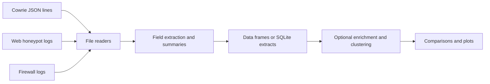

# dshield-parser

Python utilities for reading and summarizing DShield Cowrie, web honeypot, and firewall logs. The package exposes importable readers and report helpers. The scripts in [`examples/`](examples/README.md) show a research workflow that compares multiple honeypots, writes SQLite extracts, enriches selected records, and clusters URLs or commands.

## Installing

Python 3.12 or later is required by this repository's `setup.py`. A virtual environment is recommended:

```sh
python3 -m venv .venv
source .venv/bin/activate
python -m pip install --upgrade pip
python -m pip install dshield-parser
```

On Windows, activate with `.venv\Scripts\activate` instead. To work from a checkout instead of the published package, run `python -m pip install -e .` in the repository root. The package declares dependencies for data frames, plotting, SQLite access, and optional enrichment services; the pinned development versions are in `requirements.txt`.

## What it does

| Log family | Main helper module | Typical fields |
| --- | --- | --- |
| Cowrie | `dshield_parser.cowrie_processor.reports` | Source IP, username, password, command input, file hash |
| Web honeypot | `dshield_parser.web_processor.reports` | Source IP, URL, headers, method, user agent |
| Firewall | `dshield_parser.firewall_processor.reports` | Source and destination IP, port, protocol, flags |

`dshield_parser.utils.file_io` reads JSON files and JSON lines. `dshield_parser.utils.json` extracts fields and builds summaries. `dshield_parser.utils.sql`, `graphs`, `ml`, and `enrichment` support the example workflows. The repository does not define a supported command-line entry point; use the importable functions or adapt an example script.



## Using the library

Count readable Cowrie JSON events without loading the whole file into a list:

```python
from dshield_parser.utils.file_io import read_file_json_generator

count = sum(1 for _ in read_file_json_generator("cowrie.json.2024-05-01"))
print(f"Parsed events: {count}")
```

Summarize source IPs from dated Cowrie log files:

```python
from pathlib import Path
from dshield_parser.cowrie_processor import reports

logs = [Path("cowrie.json.2024-05-01"), Path("cowrie.json.2024-05-02")]
window = {"start_date": "2024-05-01", "end_date": "2024-05-02"}
counts = reports.get_summary_src_ip(logs, datespan=window)
print(counts["src_ip"])
```

This summary helper uses dates found in Cowrie **filenames** to select files. Keep dated filenames and check the actual events when you need precise event-time boundaries. It accepts an `exclusions` dictionary for exact field-value exclusions, for example `exclusions={"src_ip": "192.0.2.10"}`. Use the corresponding web or firewall report module for those log families; their field names differ.

For a multi-honeypot comparison, see [the example sequence](examples/README.md). Its scripts contain sample paths, dates, and sensor names that must be adapted to your own input layout. They are examples of a research process, not a single automatic CLI pipeline.

## Data handling

The package reads local log paths supplied by your code. Examples may create SQLite files, text, plots, or enrichment results in their working directory. Review the script's input and output paths before running it on production data. Keep logs, databases, API keys, and generated output outside the source repository. Enrichment functions that call external services require their own service configuration and may have rate or availability limits.
