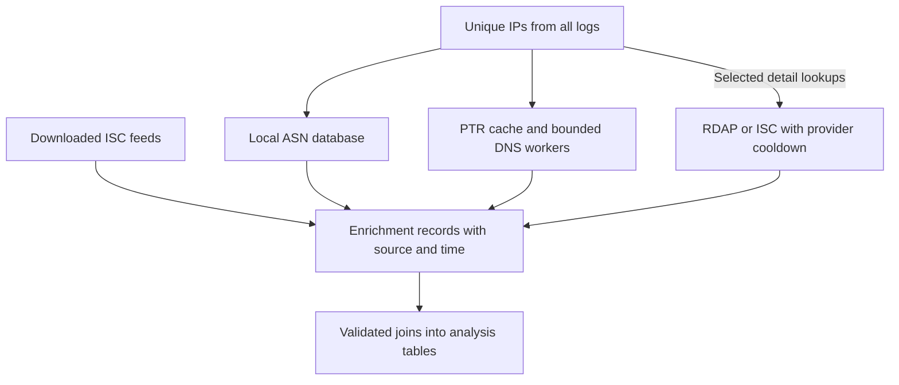

# IP enrichment in 0.2.0

Routine ASN attribution can now run against a local database. DNS, ISC and
registration detail can be collected separately with explicit deadlines,
resumable caching, and visible failure states. All public entry points remain in
`dshield_parser.utils.enrichment`; the private implementation modules separate
the local, DNS, HTTP, and SQLite responsibilities.

## Installation

From this checkout:

```sh
python -m pip install -e ".[geoip]"
python -c "import dshield_parser; print(dshield_parser.__version__)"
```

The version is `0.2.0`. The `geoip` extra installs the optional MaxMind Python
reader. Use `python -m pip install -e .` if only using IPtoASN, DNS, RDAP, or ISC.
Dnspython is a core dependency because the legacy DNS function now uses it.
After 0.2.0 is published, the equivalent package installation is
`python -m pip install "dshield-parser[geoip]==0.2.0"`.

Creating the changes in GitHub does not publish the package to PyPI. The existing
release workflow still requires a matching version tag; its test and version
checks now run before publication. The single version source is
`dshield_parser/_version.py`, read by both the package and `setup.py`.

## Public API

| Entry point | Purpose | External lookup |
| --- | --- | --- |
| `get_geoip_asn(ip, database_path=None, *, reader=None)` | ASN and associated organization from a local GeoLite2 ASN MMDB | None |
| `get_geoip_country(ip, database_path=None, *, reader=None)` | Separate geolocation and registered-country fields from a local Country/City MMDB | None |
| `load_iptoasn_database(path)` | Validate and index a plain/gzip IPtoASN TSV once | None |
| `get_iptoasn_data(ip, database)` | Binary-search the reusable IPtoASN index | None |
| `get_rdap_data(ip, *, email, ...)` | Selective registration lookup via IANA bootstrap and authoritative RDAP | HTTPS on an uncached lookup |
| `get_whois_data(ip, email, **kwargs)` | Alias for `get_rdap_data`; implements the former placeholder | Same as RDAP |
| `get_reverse_dns_info(ip, ...)` | PTR names, status, and expiration | DNS on a cache miss |
| `iter_reverse_dns(ips, *, max_workers=16, ...)` | Stream completed, deduplicated PTR results with bounded work | DNS on cache misses |
| `get_reverse_dns(ip, **kwargs)` | Compatibility wrapper returning one hostname or `""` | Same as DNS |
| `isc_ipinfo(ip, email, ...)` | Legacy ISC field dictionary with bounded requests and an optional exact-IP cache | HTTPS on a cache miss |
| `download_isc_feed(feed, destination, *, email, ...)` | Atomically download `daily_sources` or `threatintel` | HTTPS when a refresh is needed |
| `EnrichmentCache(path)` | Explicit, thread-safe SQLite cache shared across script runs | None |

New structured results include `ip`, `source`, `status`, `fetched_at`, and
`cache_hit`. DNS and RDAP add `expires_at`; local datasets instead report dataset
provenance. Times in these fields are **UTC Unix seconds**, not the time of the
original honeypot event. `isc_ipinfo` retains its `{ip: fields}` shape.



## Local ASN and country databases

### GeoLite2 ASN

Download and unpack the MMDB using your MaxMind account, following the official
[GeoLite integration guide](https://dev.maxmind.com/geoip/geolite2-free-geolocation-data/).
For regular updates, MaxMind recommends
[GeoIP Update](https://dev.maxmind.com/geoip/updating-databases/).
Keep download credentials outside the repository and follow the provider's
current attribution, update, and retention requirements.

Reuse one reader for a batch:

```python
import geoip2.database
from dshield_parser.utils import enrichment

ips = ["1.1.1.1", "8.8.8.8"]
with geoip2.database.Reader("GeoLite2-ASN.mmdb") as reader:
    records = [enrichment.get_geoip_asn(ip, reader=reader) for ip in ips]

for record in records:
    print(record["ip"], record["asn"], record["asn_organization"], record["status"])
```

For a single lookup, supply `database_path="GeoLite2-ASN.mmdb"` instead. Exactly
one of `reader` and `database_path` is required. A caller-owned reader is never
closed by the helper; a reader created for a single lookup is closed afterwards.
The supported ASN database is GeoLite2-ASN. Paid ISP databases are not handled by
this ASN method.

ASN result fields are `asn`, `asn_organization`, and `lookup_network`, plus
`dataset_build_epoch`, `dataset_type`, and `dataset_path` where available. A
caller-supplied reader has no known path, so `dataset_path` is `None`. An address
absent from the database returns `status="not_found"`. A corrupt database,
incompatible database, or invalid address raises an error instead of being
misreported as absent.

### Country or City MMDB

```python
from dshield_parser.utils.enrichment import get_geoip_country

record = get_geoip_country("1.1.1.1", "GeoLite2-Country.mmdb")
print(record["geo_country"], record["registered_country"])
```

GeoLite2/GeoIP2 Country and City databases are supported. `geo_country` is the
source's IP geolocation country; `registered_country` is a distinct registration
attribute. Neither is automatically the ISC `ascountry` field or evidence of an
attacker's physical location.

### IPtoASN

Download an ASN dataset from [IPtoASN](https://www.iptoasn.com/), keep it outside
the repository, then load it once:

```python
from dshield_parser.utils import enrichment

database = enrichment.load_iptoasn_database("ip2asn-combined.tsv.gz")
records = [
    enrichment.get_iptoasn_data(ip, database)
    for ip in ["1.1.1.1", "8.8.8.8", "2606:4700:4700::1111"]
]
```

The five TSV columns are `range_start`, `range_end`, `AS_number`, `country_code`,
and `AS_description`. Plain and gzip files, integer IPv4 endpoints, IPv6, and
combined files are supported. The loader rejects malformed, overlapping,
unsorted, empty, and truncated datasets. Lookups use binary search; they do not
reopen or scan the file for each IP. Reload the index after replacing the file.

Results include `asn`, `asn_organization`, `source_country`, `range_start`, and
`range_end`. Inclusive source ranges can span multiple CIDRs, so no BGP prefix is
invented. AS0/unallocated ranges and missing ranges return `not_found`.
`dataset_mtime`, `dataset_mtime_ns`, and `dataset_size_bytes` identify the local
file at load time; its modification time is not claimed to be the upstream build
date. The IPtoASN public API is discontinued; these functions use downloads.

### Field meanings when migrating

| Old ISC field | Local replacement |
| --- | --- |
| `as` | `asn`, with provider recorded |
| `asname` | `asn_organization`; names can differ across providers |
| `network` | `lookup_network` for MaxMind, or explicit start/end ranges for IPtoASN |
| `ascountry` | No silent substitution; retain separate country fields |
| `assize` | No direct replacement in these basic lookups |
| `updated` | Preserve source meaning; use separate fetch/build timestamps |

A matched lookup prefix, routing announcement, and registered address range are
different concepts. The size of one prefix is not the size of an entire ASN.
Local ASN records do not contain complete WHOIS contacts or ISC activity counts.

## Persistent cache and reverse DNS

Use one cache file at a stable location across runs. The path is explicit for
library calls. The cache stores JSON records with unique `(namespace, key)` pairs
and per-record expiration. It may be shared by threads; independent instances can
open the same local SQLite file. Close it after its workers have finished.

```python
from pathlib import Path
from dshield_parser.utils import enrichment

cache_file = Path.home() / "dshield-parser-cache" / "enrichment.sqlite"
ips = ["1.1.1.1", "8.8.8.8", "1.1.1.1"]
with enrichment.EnrichmentCache(cache_file) as cache:
    for record in enrichment.iter_reverse_dns(
        ips, cache=cache, max_workers=16, timeout=1.0, lifetime=3.0,
    ):
        print(record["ip"], record["reverse_dns"], record["status"])
```

The generator yields **completion order**. Join using `record["ip"]`, never list
position. Inputs are canonicalized and deduplicated, with at most `max_workers`
lookups in flight. The deduplication set still grows with distinct IPs. Each result
is saved before it is yielded, so an interrupted run can reuse completed fresh
records. Closing the generator cancels unstarted work and waits for active DNS
lookups to complete within their resolver lifetime.

| DNS status | Meaning | Cache behavior |
| --- | --- | --- |
| `ok` | At least one PTR was returned | Uses the answer's original expiration |
| `nxdomain` | DNS returned name nonexistence | Uses the negative SOA lifetime, including alias limits |
| `no_ptr` | A DNS answer contains no PTR | Uses its negative lifetime when supplied |
| `timeout` | Total DNS lookup lifetime expired | Separate short failure cooldown |
| `resolver_error` | Nameservers/transport could not resolve the question | Separate short failure cooldown |

`ptr_names` retains all returned names. `reverse_dns` provides the first name or
an empty string. A negative response without a defensible SOA lifetime is not
persisted as fresh. A timeout is never treated as proof of no PTR. Temporary
failures default to a 60-second cooldown; set `failure_ttl=0` to disable that.

The default resolver uses the host's configured DNS service and an explicit
dnspython in-memory cache. `timeout` is the per-server wait; `lifetime` bounds the
DNS question. A supplied dnspython resolver is copied before changing timing
settings, preserving the caller's configuration. Configure a resolver before
sharing it between workers. A custom resolver must honor the supplied lifetime;
it can provide `enrichment_cache_identity` for a stable cache view. Normal
resolver cache keys include resolver/transport identity to separate DNS views.

For compatibility, `get_reverse_dns(ip, cache=cache)` still returns a string.
Use the structured function when the distinction between absence and failure
matters. Putting a timeout on a thread Future alone does not stop the underlying
OS resolver; this implementation places the deadline inside the DNS resolver.

## Selective RDAP registration detail

```python
import os
import requests
from dshield_parser.utils import enrichment

with enrichment.EnrichmentCache("enrichment.sqlite") as cache, requests.Session() as session:
    try:
        record = enrichment.get_rdap_data(
            "1.1.1.1", email=os.environ["DSHIELD_CONTACT_EMAIL"],
            cache=cache, session=session,
        )
    except enrichment.EnrichmentRateLimitError as exc:
        print("Save this lookup as pending until", exc.retry_at)
    except enrichment.EnrichmentError as exc:
        print("Provider lookup failed:", exc)
    else:
        print(record["status"], record["network"], record["abuse_contacts"])
```

The client caches IANA IPv4/IPv6 bootstrap data, selects the most-specific matching
service, and retrieves the authoritative IP network record over HTTPS. You can
instead pass `bootstrap` as an IANA-style dictionary, a prefix-to-HTTPS-base map,
or a path to either JSON form. HTTPS redirects and exact-IP RDAP referrals are
bounded. The returned range must contain the requested IP.

Results include `network` (handle, name, start/end addresses, country and related
registration fields), `entities`, `abuse_contacts`, and `raw`. Contacts are
extracted only from entities already in the response. There is no recursive
entity retrieval, extra ASN query, or port-43 WHOIS request. Data omitted by the
registry remains absent. A non-global address returns `not_global`; HTTP 404
becomes a short-lived `not_found` result. Other failures raise `EnrichmentError`.

The default successful RDAP cache lifetime is seven days and is configurable with
`cache_ttl`. Cache identity includes the exact query URL; records are not applied
to an entire parent subnet or ASN. Registration data remains separate from ASN,
geolocation, per-IP threat observations, and PTR data.

## ISC requests and static feeds

The legacy call remains usable:

```python
from dshield_parser.utils import enrichment

with enrichment.EnrichmentCache("enrichment.sqlite") as cache:
    data = enrichment.isc_ipinfo("1.1.1.1", "analyst@example.org", cache=cache)
    print(data["1.1.1.1"]["asname"])
```

Its default exact-IP cache lifetime is 24 hours. The inner field dictionary also
includes `fetched_at`, `expires_at`, and `cache_hit`, so callers can distinguish
the original observation time from cache reuse. Optional missing XML fields are
`None`; HTML or malformed success responses are errors. Contact information is
required for HTTP User-Agent identification. Use the rate-limit handling shown
above around this call in long-running jobs.

HTTP functions default to `(3.05, 10)` seconds for connect/read timeouts and three
attempts. These are connection/read-inactivity limits, **not a total wall-clock
deadline for a complete download**. Temporary transport errors and selected 5xx
responses receive short capped backoff. Permanent HTTP failures do not retry
forever. HTTP 429, and 503 with Retry-After, immediately raise
`EnrichmentRateLimitError`, exposing `origin`, `retry_after`, and `retry_at`.
Retry-After seconds and HTTP dates are supported; ISC's HTML delay is a fallback,
then a conservative 300-second fallback. No worker sleeps for that five-minute
interval. Known origin-wide cooldowns prevent subsequent requests, including
lookups for different IPs. Passing the persistent cache retains cooldowns across
processes. Cached successful data can still be used while a provider is cooling
down. Respect `retry_at`; resume pending work later rather than increasing load.

Static ISC feeds can be downloaded separately:

```python
from dshield_parser.utils import enrichment

with enrichment.EnrichmentCache("enrichment.sqlite") as cache:
    result = enrichment.download_isc_feed(
        "threatintel", "feeds/threatintel.txt",
        email="analyst@example.org", cache=cache,
    )
    print(result["path"], result["status"])
```

The other supported feed name is `daily_sources`. The helper keeps the original
feed text; it does not guess a schema or claim that a daily feed replaces every
field of `/api/ip`. Ingest only fields and time windows appropriate for your
analysis. Absence from a feed does not mean benign.

Reuse a stable destination. An unchanged file downloaded within the last hour is
reused for that feed/path; cache metadata makes that behavior survive restarts.
The default maximum download size is 256 MiB, configurable with `max_bytes`.
Downloads stream to a temporary file in the destination directory and replace the
destination only after a successful nonempty download. HTML/error responses,
oversized downloads, and interrupted transfers leave the last good file intact.
Refresh jobs should follow [ISC's feed guidance](https://isc.sans.edu/feeds_doc.html)
and avoid fetching more frequently than hourly.

## Updating the example workflow

`examples/clear_research_ips.py` uses a shared cache path and the bounded DNS batch
helper. It supports these environment settings (set them in the same shell that
starts the script):

| Variable | Purpose |
| --- | --- |
| `DSHIELD_CONTACT_EMAIL` | Contact address for ISC and other HTTP requests |
| `SHODAN_API_KEY` | Optional Shodan key; an unset key skips Shodan-only lookups |
| `DSHIELD_ENRICHMENT_CACHE` | Cache file; defaults to `~/dshield-parser-cache/enrichment.sqlite` |
| `DSHIELD_ASN_MMDB` | GeoLite2 ASN MMDB path for local ASN attribution |
| `DSHIELD_IPTOASN_FILE` | IPtoASN TSV/gzip path as an alternative local provider |

Set at most one local ASN path. Without either, the example continues to use ISC
for ASN/network context, with bounded requests and the new exact-IP cache. The
example still uses other external scanner/researcher feeds even when ASN lookups
are local; the standalone local functions themselves perform no network calls.
Optional feed failures do not stop local ASN processing. The separate
`enrichment_sources` output table records `source`, `status`, `checked_at`,
`retry_at`, and a sanitized `error` category. Its statuses are `ok`, `deferred`,
`error`, `unavailable`, or `skipped`. `checked_at` is the source availability
assessment time, not the source record's observation time. Check this table
before interpreting missing labels; missing evidence never proves an IP benign.

PowerShell configuration example:

```powershell
$env:DSHIELD_CONTACT_EMAIL = "analyst@example.org"
$env:DSHIELD_ASN_MMDB = "C:\Enrichment\GeoLite2-ASN.mmdb"
$env:DSHIELD_ENRICHMENT_CACHE = "C:\Enrichment\enrichment.sqlite"
python examples/clear_research_ips.py
```

Edit the example's input database and date settings for your run. Add the Shodan
environment variable only if you want those lookups. Keep actual keys outside
tracked files.

The example reports `enrichment_status` and `enrichment_retry_at` for pending
ISC data. It does not pretend a partially enriched output is complete. Rerun
after the provider cooldown to resume using fresh cached successes. Local
results retain `enrichment_source`, a local lookup timestamp, and separate
IPtoASN range/country fields. `ascountry`, `assize`, and ISC `updated` are left
empty when the local provider cannot supply their original meanings.

The old `ip_lookups.txt` is no longer automatically consumed by this example.
Its entries have no reliable local fetch/expiration time and previously reused
arbitrary parent networks. Keep it as a historical artifact if needed. A first
run with the new cache needs fresh ISC results or a configured local dataset;
subsequent runs reuse fresh cache entries. This change prevents cached subnet
copies from multiplying event rows.

Scanner/research labels are aggregated for one-row-per-IP joins while raw label
records remain in their separate output tables. Joins validate many-to-one
cardinality. Onyphe and LeakIX now have separate correct labels. PTR results cover
the union of web, Cowrie, and firewall IPs. Logging and provider status distinguish
lookup failures from confirmed absence.

## Testing and release checks

```sh
python -m pip install ".[geoip]" build setuptools wheel
python -m unittest discover -s dshield_parser/test -p "test_enrichment*.py" -v
python -m build
```

Tests use synthetic addresses, fake provider responses, temporary SQLite files,
and DNS records. They do not send real DNS/ISC/RDAP requests. Coverage includes
range boundaries and IPv6, optional reader behavior, cache persistence/expiry,
negative TTLs, bounded DNS work, retry/cooldown behavior, response validation,
atomic feed updates, public API compatibility, and workflow merge cardinality.

The older `test_json.py` suite references honeypot fixture files absent from this
repository; it is not represented as passing by these enrichment checks. CI runs
the self-contained enrichment suite and builds the package on Linux and Windows.
The release workflow verifies that the pushed tag matches the package version
and runs the same enrichment suite before publishing.

## Source references and remaining scope

- [MaxMind ASN fields](https://dev.maxmind.com/geoip/docs/databases/asn/binary/)
- [MaxMind Python reader](https://github.com/maxmind/GeoIP2-python)
- [IPtoASN downloadable datasets](https://www.iptoasn.com/)
- [ISC API usage and throttling](https://isc.sans.edu/api/)
- [ISC static feeds](https://isc.sans.edu/feeds_doc.html)
- [Authoritative RDAP discovery, RFC 9224](https://www.rfc-editor.org/rfc/rfc9224.html)
- [RDAP rate limits, RFC 7480](https://www.rfc-editor.org/rfc/rfc7480.html#section-5.5)
- [Dnspython resolver timing](https://dnspython.readthedocs.io/en/stable/resolver-class.html)
- [Dnspython cache behavior](https://dnspython.readthedocs.io/en/stable/resolver-caching.html)

Bulk RIR mirrors and licensed Internet-wide PTR snapshots require separate data
acquisition, terms, and import design. This release does not download or mirror
them. It supplies local ASN/country lookups, selective RDAP, TTL-aware PTR results,
and safe ISC feed downloads for the pipeline's immediate needs. For historical
research, record event time, enrichment observation time, and dataset provenance
separately; current attribution is not proof of ownership at an earlier date.
