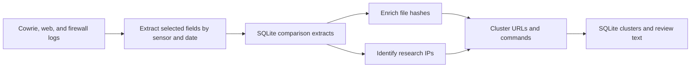
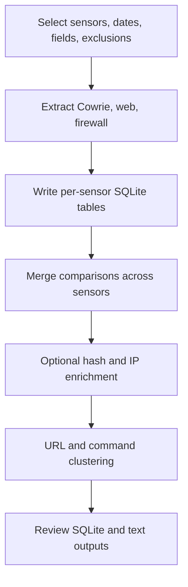

# Example analysis workflow

These scripts illustrate a research analysis of several DShield honeypots. Edit each script's paths, date range, selected sensors, and output directory before running it. They are examples, not a packaged command-line interface; individual scripts use local configuration values and may require enrichment service access.

## IP enrichment configuration in 0.2.0

`clear_research_ips.py` uses persistent bounded reverse DNS and one metadata row
per IP. Configure `DSHIELD_CONTACT_EMAIL` for HTTP lookups and optionally
`SHODAN_API_KEY` for Shodan. Set `DSHIELD_ASN_MMDB` or `DSHIELD_IPTOASN_FILE` to
use a downloaded local ASN database; without either, ISC remains the source for
ASN/network context. Set `DSHIELD_ENRICHMENT_CACHE` to reuse a chosen SQLite cache
across runs; its default is `~/dshield-parser-cache/enrichment.sqlite`.

The local ASN option does not disable the script's other external scanner feeds.
IP metadata and DNS status columns make incomplete enrichment visible. The old
`ip_lookups.txt` cache is no longer automatically consumed. See the
[enrichment guide](../docs/IP-ENRICHMENT.md#updating-the-example-workflow) for
examples, field meanings, migration details, and provider retry behavior.

## Sequence

1. [`dshield_honeypot_comparisons_dbs_exclusions.py`](dshield_honeypot_comparisons_dbs_exclusions.py) discovers sensor directories, extracts selected Cowrie, web, and firewall fields for a configured date range, applies configured exclusions, and writes per-sensor and combined SQLite comparison tables. It uses the library's JSON and SQL helpers.
2. [`enrich_summary_hashes.py`](enrich_summary_hashes.py) adds VirusTotal context for file hashes from the extract database. It writes a `hashes` table to that database.
3. [`clear_research_ips.py`](clear_research_ips.py) combines IP context from configured sources to help distinguish research or infrastructure traffic. It writes an enrichment-mapping database.
4. [`url-command-clustering.py`](url-command-clustering.py) explores URL and command similarity across honeypots with clustering parameters, producing SQLite cluster data and review text.

Run from a checkout with `python -m pip install -e .` completed. The scripts use their own paths rather than a shared config file, so review each script before executing it. A typical invocation is `python examples/dshield_honeypot_comparisons_dbs_exclusions.py` after adapting its settings. Subsequent scripts expect the SQLite artifacts made by the earlier steps; update their input filenames to match your run.

The extraction example groups and counts records by selected fields and day. Across sensors, it uses an outer merge so a pattern seen at only one sensor still appears. Its aggregate counts describe the selected records and exclusion rules, not unique attack sessions. Review the schema and join keys before comparing totals or combining this output with another project's session database.

The existing [processing diagram](data_processing_diagram.PNG) is a reference for the original research workflow. The Mermaid diagrams above describe the same sequence in editable text.

